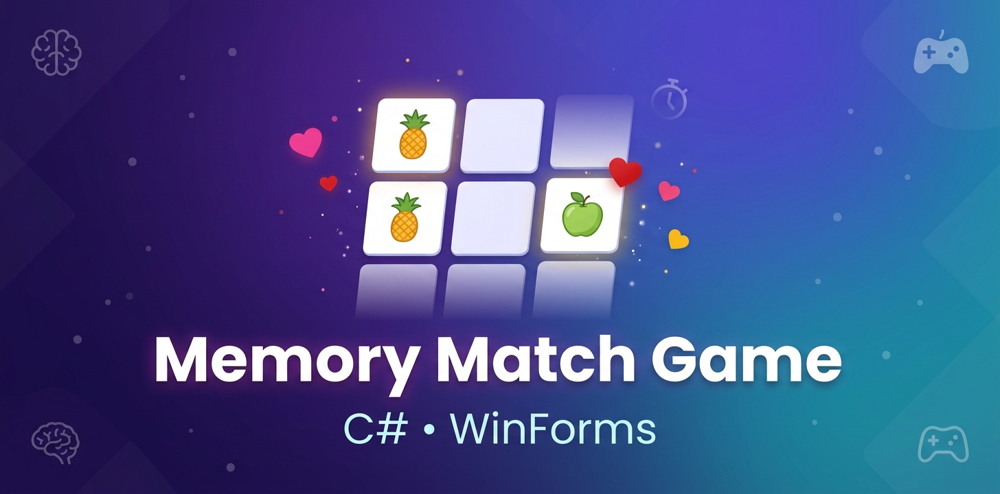

# 🎮 Memory Match Game

A classic memory game built with **C#** and **Windows Forms** — test your observation and concentration skills!

---

## ✨ Features

- 🎚️ **3 Difficulty Levels:**
  - 🟢 **Easy** — 6 buttons (3 pairs)
  - 🟡 **Intermediate** — 12 buttons (6 pairs)
  - 🔴 **Hard** — 18 buttons (9 pairs)

- ❤️ **Lives System:**
  - 5 lives per round
  - Lose a life on each wrong match
  - Game Over when lives run out

- ⏱️ **Smart Countdown Timer:**
  - Shows remaining time to restore each life
  - Progressive timing based on remaining lives

- 🎵 **Sound Effects:**
  - Different sounds for match, wrong, and win
  - More interactive gameplay experience

- 🎲 **Random Distribution:**
  - Images are randomly distributed each round
  - Every game is unique!

---

## 🛠️ Technologies Used

| Technology | Purpose |
|------------|---------|
| **C#** | Programming Language |
| **Windows Forms** | UI Framework |
| **OOP** | Object-Oriented Programming |
| **Inheritance** | BaseForm for code reuse |
| **Timers** | Time management |
| **SoundPlayer** | Audio effects |

---

## 🚀 How to Run

1. **Clone the repository:**
   ```bash
   git clone https://github.com/Mahmoud-Alkhatib1/Memory-Match-Game.git
   ```

2. **Open `Project.sln` in Visual Studio**

3. **Press `F5` to run**

---

## 💡 What I Learned

- ✅ **OOP principles** in a real project
- ✅ **Inheritance** to reduce code duplication
- ✅ **Event handling** in WinForms
- ✅ **Timers** management
- ✅ **Code organization** across multiple files

---

## 👨‍💻 Author

**Mahmoud Alkhatib**
- GitHub: [@Mahmoud-Alkhatib1](https://github.com/Mahmoud-Alkhatib1)
- LinkedIn: [Mahmoud Alkhatib](https://www.linkedin.com/in/mahmoud-alkhatib1/)

---

## 📄 License

This project is licensed under the **MIT License** — see the [LICENSE](LICENSE) file for details.

---

⭐ **If you like this project, don't forget to give it a star!** ⭐
